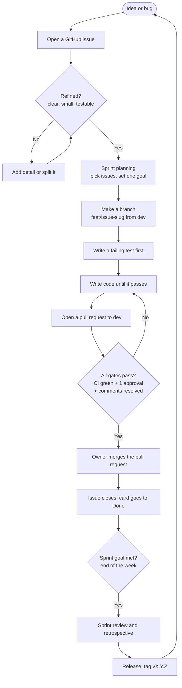

# shipquick_latest

A ready-to-use starter kit for building web and mobile applications using Google's Material Design 3 (M3) system.

## What is this?

**shipquick_latest** is a pre-built foundation that gives you everything you need to start a software project immediately. Think of it like a "starter kit" or "toolbox" for building apps.

Inside, you get:
- An organized folder structure
- Design tools (colors, fonts, spacing)
- Ready-made user interface components
- Architecture patterns for backend and frontend
- A safe development workflow (feature branches, automatic checks, releases)

## Who is this for?

This is for anyone who wants to build an app quickly and consistently. Whether you are:
- A designer wanting to use a professional design system
- A developer wanting to start fast without building everything from scratch
- A team wanting to follow consistent patterns

## What problem does it solve?

Building an app from scratch takes a lot of time. You have to:
- Decide on colors and fonts
- Create a folder structure
- Build basic components (buttons, forms, etc.)
- Set up design rules
- Set up safe ways to add new features without breaking old ones

**shipquick_latest** already has all of this set up. You just need to customize it with your own brand colors and fonts.

## What can you build?

Not just websites. You can build for many platforms:

| Platform | How | Status |
|---|---|---|
| **Web app** | React + Material Design 3 web components | Ready now |
| **Progressive Web App (PWA)** | Same web code, runs like a mobile app | Ready now |
| **Android app** | Material Design 3 Android components, same design tokens | Design ready, code next |
| **iOS app** | Material Design 3 iOS components, same design tokens | Design ready, code next |
| **Flutter app** | Material Design 3 Flutter widgets, same design tokens | Design ready, code next |

The design tokens (colors, fonts, spacing) stay the same everywhere. Only the code changes per platform.

## What's inside?

Here is the folder structure explained simply:

```
shipquick_latest/
├── README.md          ← This file (tells you what everything is)
├── CLAUDE.md          ← Rules to follow when working on the project
├── COMMIT_GUIDELINES.md ← How to write commit messages
├── .gitignore         ← Files that stay out of git (models, logs, secrets)
├── .editorconfig      ← Code formatting rules
├── .pre-commit-config.yaml ← Automatic checks before every commit
├── scripts/           ← Helper scripts (commit checks, markdown checks)
├── docs/              ← All documentation (guides, plans, decisions)
│   ├── architecture.md← How the system is organized
│   ├── design-tokens.md ← Colors, fonts, spacing values (replace with your own)
│   ├── PLAN.md        ← The step-by-step plan for building your project
│   ├── development-flow.md ← How development works (diagram + plain words)
│   ├── process-trace.md ← What has been done so far (updated each session)
│   ├── test-cases.md  ← How to test your project
│   ├── decisions/     ← Architecture decisions (ADR files)
│   └── design-system.md ← Master design reference (platforms, tokens, options)
├── design/            ← Design system (Material Design 3)
│   ├── AGENTS.md      ← Rules for AI assistants
│   ├── CLAUDE.md      ← Session rules
│   ├── USAGE_GUIDE.md ← What to use vs study only
│   ├── UPDATE_PROCESS.md ← How upstream updates reach this repo
│   └── material-design-3/ ← Vendored guides
│       ├── REPOSITORIES.md ← All 10 repos indexed
│       ├── web/         ← Web setup guides
│       ├── mdc-web/     ← Web integration guides
│       ├── android/     ← Android setup guides
│       └── ios / flutter READMEs ← Mobile overviews
├── .github/           ← Automatic testing and releases
│   ├── workflows/
│   │   ├── ci.yml     ← Runs checks and tests on every change
│   │   └── cd.yml     ← Creates releases at each demo
│   └── PULL_REQUEST_TEMPLATE.md ← Checklist for every change request
├── backend/           ← Backend architecture and patterns
│   ├── AGENTS.md      ← Rules for AI assistants
│   ├── CLAUDE.md      ← Session rules
│   └── architecture-portal/
│       ├── ARCHITECTURE_PATTERNS.md ← Backend and frontend patterns
│       ├── USAGE_GUIDE.md ← What to use vs what to study only
│       └── docs/      ← Design records by domain (Database, Events, API, AI/ML...)
├── frontend/          ← Front-end setup and patterns (starts with a short README)
│   └── README.md      ← What goes here
└── pm/                ← Product management and agile
    └── agile/         ← Guides, templates, sprint records
        ├── AGILE_GUIDE.md      ← The process model
        ├── PRIORITIZATION.md   ← Value-first ranking
        ├── templates/          ← Story, sprint, retro, release templates
        └── sprints/            ← One folder per sprint (plan, review, retro)
```

## How Development Works (the flow)

This is the repeatable process. It is the same for every feature and every bug.
It works the same whether you write the code by hand or an AI writes it for you.



In one line: **idea → issue → refine → plan → branch → test first → pull request → gates → owner merges → release.**
The loop repeats every week (one sprint).

New to GitHub? Read the full walkthrough in `docs/development-flow.md`. It explains every word in plain English.

## Safe Development Workflow

Every change goes through branches so a broken feature never breaks the rest:

```
feat/<issue>-<slug>  →  dev  →  main
   (your work)      (testing)   (release)
```

| Branch | Purpose | Rule |
|---|---|---|
| `main` | Release-ready code | Protected. Only the owner merges. Never push direct. |
| `dev` | Integration and testing | Protected. Changes arrive only via pull requests. |
| `feat/<issue>-<slug>` | One feature at a time | Branched from `dev`. Deleted after merge. |

If a feature breaks, only its branch is affected. Roll back by closing its pull request.

### Automatic Checks

Every change is checked automatically:

| Check | What it does |
|---|---|
| Pre-commit | No secrets, no files over 500KB, no merge markers |
| Commit message | Must follow `COMMIT_GUIDELINES.md` (e.g. `feat(auth): add login`) |
| PR size | Max 50 files per request, so reviews stay easy |
| Tests | Python tests run on every push |
| Releases | Tags like `v0.4.0` need a demo note and a changelog entry. See `pm/agile/RELEASE_GUIDE.md` |

## Design Tokens (Colors and Fonts)

The system uses **Design Tokens** - these are named values for colors, fonts, and spacing that you can use on every platform.

### Current Tokens (Replace with your own):

| Token | What it is | Your brand value |
|---|---|---|
| `<PRIMARY_COLOR>` | Your main brand color | `#YourColorHere` |
| `<PRIMARY_DARK>` | Darker version of main color | `#YourDarkColorHere` |
| `<TEXT_COLOR>` | Main text color | `#YourTextColorHere` |
| `<BG_COLOR>` | Page background color | `#YourBackgroundColorHere` |
| `<PRIMARY_FONT>` | Font family for text | `YourFontName` |
| `<SPACING_UNIT>` | Base spacing size | `4` or `8` |

**To change these**: Open `docs/design-tokens.md` and replace the `<PLACEHOLDER>` values with your brand's colors and fonts. The same values work on web, Android, iOS, and Flutter.

## Material Design 3

This project uses **Material Design 3** - a design system created by Google. Full reference: `docs/design-system.md` and `design/material-design-3/REPOSITORIES.md` (all 10 repos indexed). It provides:
- Professional, modern-looking components
- Consistent design patterns that work on all devices
- Pre-built buttons, forms, dialogs, and more
- Ready libraries for web, Android, iOS, and Flutter

### Key Material Design 3 Components

You can use these ready-made components in your project:

| Component | What it does | How to use |
|---|---|---|
| `MDCButton` | A styled button | `<MDCButton>Click me</MDCButton>` |
| `MDCTextField` | A form input field | `<MDCTextField>` |
| `MDCCheckbox` | A check box option | `<MDCCheckbox>` |
| `MDCRadio` | Option buttons (select one) | `<MDCRadio>` |
| `MDCSelect` | A dropdown menu | `<MDCSelect>` |
| `MDCDialog` | A pop-up window/modal | `<MDCDialog>` |
| `MDCTopAppBar` | A header/app bar | `<MDCTopAppBar>` |
| `MDCFab` | A floating action button (like a plus sign) | `<MDCFab>` |
| `MDCSnackbar` | A brief message at the bottom | `<MDCSnackbar>` |

**To use these**: You need to install the Material Design package. See the Quick Start section below.

## Architecture Patterns

The `backend/` folder holds proven architecture patterns for backend and frontend:

| Domain | What you get |
|---|---|
| Database | Schema and review patterns |
| Event Brokers | Async messaging patterns |
| API Integration | Gateway and contract patterns |
| Big Data | Batch and stream patterns |
| Observability | Monitoring and audit patterns |
| AI/ML | Model versioning and eval patterns |
| Build vs Buy | Decision templates |
| Front-End and Mobile | Shared design system patterns |

Read `backend/architecture-portal/USAGE_GUIDE.md` first — it tells you what to use directly and what to study only.

## PM and Agile

Planning and process live in `pm/agile/`. It is lightweight Scrum.

- A **PI** is a D increment (an epic). A **sprint** is one week and one GitHub milestone. A **story** is one issue and one PR.
- Work is ranked by **value**, not by time. AI writes the code, so the real limit is review bandwidth. No hours, no story points.
- Size is a **T-shirt** (`XS, S, M, L, XL`). Size means change surface and risk.
- Versions use **SemVer** `vX.Y.Z`. A D increment is a minor bump.

Start with `pm/agile/AGILE_GUIDE.md`. Templates are in `pm/agile/templates/`.

## Quick Start

### 1. Get the project

```bash
# Clone this repository to your computer
git clone <url> <your-project-name>

# Go into the project folder
cd <your-project-name>
```

### 2. Turn on the checks and pick a mode

```bash
# Install pre-commit once (or: brew install pre-commit), then run the checks on every commit and push
pip install pre-commit
pre-commit install

# Run the same checks by hand once; it must say "all passed"
bash scripts/check_local.sh sizes markers md-blocks
```

- Pick how much the AI agents do alone (`docs/MODES.md`). Type `/mode` in Claude Code to see the mode. Set it yourself by typing `! bash scripts/mode.sh set manual` (or `semi`, `auto`); an agent never sets it.
- Give your project its live roadmap page: put your title and vision in `roadmap.json`, then follow `docs/LIVE_ROADMAP.md`.

### 3. Create your feature branch

```bash
# Always branch from dev, never from main
git checkout dev
git checkout -b feat/1-my-first-feature
```

### 4. Install the design tools

```bash
# Install Material Design components
npm install @material/web
```

### 5. Start building

You can now start using the components and design tokens. Here's a simple example:

```html
<!-- A primary button using your brand color -->
<button style="
  --md-primary: #YourPrimaryColor;
  --md-on-primary: #YourTextOnPrimaryColor;
">
  Click Me
</button>
```

### 6. Send your change for review

```bash
git push origin feat/1-my-first-feature
```

Then open a pull request to `dev`. Checks run automatically.

## How to Customize for Your Brand

### Step 1: Set Your Brand Colors and Fonts

1. Open `docs/design-tokens.md`
2. Run `python3 scripts/check_placeholders.py`. It lists every placeholder in the file (and the stub vision line in `roadmap.json`, if you have one), such as `<PRIMARY_COLOR>`, `<PRIMARY_FONT>` and `<SPACING_1>`.
3. Replace each one with your value, for example `#0066CC` for a color, `Roboto` for a font, or `8` for a spacing step.
4. Run the check again. When it says "no placeholders left", you are done.

### Step 2: Update the Color Palette

The system comes with default Material Design 3 colors. You can change these to match your brand by editing the values in `docs/design-tokens.md`.

### Step 3: Follow the Guidelines

- **Use design tokens** instead of hardcoded colors (e.g., use `var(--md-primary)` instead of `#0066CC`)
- **Use Material Components** for buttons, forms, and other UI elements
- **Follow the folder structure** - keep new files in the appropriate folders
- **Read `docs/process-trace.md`** first in every working session
- **Follow CLAUDE.md** standing rules

## Folder Structure Guide

Here's how to know where to put things:

| Folder | What goes here? | Example |
|---|---|---|
| `docs/` | Documentation, guides, plans | `architecture.md`, `design-tokens.md` |
| `backend/` | Backend architecture and patterns | ADRs, usage guides, domain docs |
| `frontend/` | Front-end setup and patterns | React components, onboarding flows |
| `pm/agile/` | Product management and agile process | Sprint plans, retros, templates |
| `.github/` | Automatic testing and releases | CI config, PR template |
| `scripts/` | Helper scripts | Commit checks, markdown checks |

## What Will You Build?

With **shipquick_latest**, you can build:
- A personal website or portfolio
- A business landing page
- An internal tool or dashboard
- A customer-facing web application
- A mobile app (Android, iOS, Flutter) sharing the same design
- Any app that needs a professional, consistent design

## Need Help?

- Read `docs/process-trace.md` first (this is the most important rule)
- Check `CLAUDE.md` for session rules
- Look at `docs/architecture.md` for system guidelines
- Read `backend/architecture-portal/USAGE_GUIDE.md` before using patterns
- Replace design tokens in `docs/design-tokens.md` with your brand values
- Use the Material Design components listed above

## Permanent Location

This repository is stored at:
```
https://github.com/satvik-jain-iitd/shipquick_latest
```

Clone it to start new projects.

---

## Philosophy

**shipquick_latest** is based on the belief that "All software is just Human logic written in Machine language." It provides the human logic (design systems, patterns, structure) so you can focus on writing what makes your project unique.

The name "shipquick" represents the goal: to help you ship (complete and deliver) your project quickly with a solid foundation already in place.
