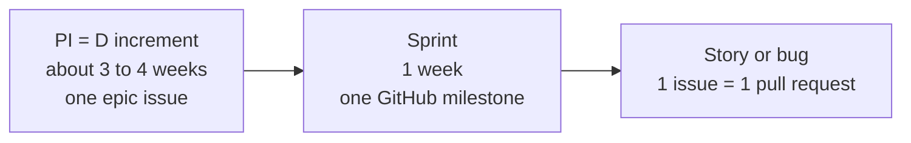
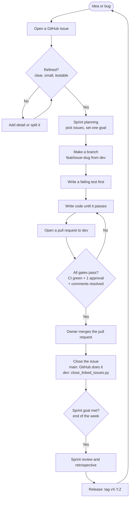
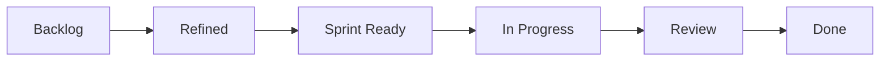

# Development Flow

This page shows how work moves from an idea to a release.

It is the same for every feature and every bug. Follow it and nothing breaks.

New to GitHub? No problem. Every word is explained at the bottom.

## The three levels

Work is grouped by size. Big goal, then a week, then one task.

- A **PI** is a D increment. It is a big goal. It takes about 3 to 4 sprints.
- A **sprint** is one week. It is one GitHub milestone.
- A **story** or **bug** is one issue. One issue is one pull request.

## The full flow

This is the repeatable process. It loops forever.

## The steps in plain words

1. **Start with an idea or a bug.** Write it as a GitHub issue.
2. **Refine it.** Make it clear, small, and testable. If it is big, split it. Then it is Ready.
3. **Plan the sprint.** Each week, pick Ready issues. Write one sprint goal.
4. **Make a branch.** Branch from `dev`, never from `main`. Name it `feat/<issue>-<slug>`.
5. **Write the test first.** Watch it fail. Then write code until it passes.
6. **Open a pull request to `dev`.** Checks run on GitHub by themselves.
7. **Pass the gates.** Green CI, one approval (not the author), no open comments.
8. **The owner merges.** Into `main`, GitHub closes the issue. Into `dev`, GitHub does not. Run `python3 scripts/close_linked_issues.py <pr>` to list the linked story issues, get one yes from the owner, then close them with `--yes`. The card moves to Done.
9. **At week end, review and retrospect.** Show what works. Note what to change.
10. **Release.** Tag a version like `v0.4.0`. Start the next loop.

## The board

Every issue moves left to right across the board.

- **Backlog**: a new issue lands here.
- **Refined**: the issue is clear and sized.
- **Sprint Ready**: chosen for this week.
- **In Progress**: being built. Keep this to 2 items at most.
- **Review**: a pull request is open.
- **Done**: merged and closed.

## Words you will see on GitHub

| Word | What it means |
|---|---|
| Issue | A to-do card. One idea, one bug, or one story. |
| Pull request (PR) | A proposed change. Others review it before it joins the code. |
| Branch | A safe copy of the code where you work. |
| Merge | Join your branch into the main code. |
| Milestone | A bucket with a due date. We use it for a sprint. |
| Checks / CI | Automatic tests that run on GitHub for every change. |
| Tag / release | A saved version of the code, like `v0.4.0`. |

## Roles

- **Owner**: decides priority, reviews, approves, and merges.
- **Builder** (you, or an AI): writes the code, the tests, and the pull request.

## Where the details live

- The process model: `pm/agile/AGILE_GUIDE.md`
- How to rank work: `pm/agile/PRIORITIZATION.md`
- How to groom a story: `pm/agile/REFINEMENT.md`
- Planning a week: `pm/agile/SPRINT_PLANNING.md`
- Planning a PI: `pm/agile/PI_PLANNING.md`
- Retro: `pm/agile/RETROSPECTIVE.md`
- Releases: `pm/agile/RELEASE_GUIDE.md`
- Merge rules: `docs/PR_RULES.md`
